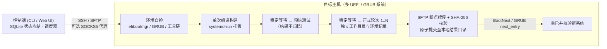

# AutoBench

<p align="center">
  <strong>面向多系统环境的自动化、可断点恢复 Linux 性能基准测试编排工具</strong>
</p>

<p align="center">
  <a href="https://github.com/colorfulshark/autobench/actions/workflows/tests.yml"></a>
  = 3.11">
  
  
</p>

AutoBench 通过 SSH/SFTP 在多台物理机或虚拟机上自动调度性能测试，支持**在同一台机器的多个 UEFI 操作系统或共享 GRUB 启动项之间自动切换、构建、预热、多轮执行并安全回收原始结果**。内置零前端构建依赖的中文 **Web 测试工作台** 与 **UnixBench 多组对比报告（网页 + Excel）**，即使本地控制端断网、退出或重启，远端由 `systemd` 托管的测试任务仍会继续执行，并可通过 `resume` 无缝接管。

---

## 目录

- [核心特性](#核心特性)
- [工作原理](#工作原理)
- [环境要求](#环境要求)
- [快速开始](#快速开始)
- [CLI 命令参考](#cli-命令参考)
- [配置说明](#配置说明)
- [Web 管理台与对比报告](#web-管理台与对比报告)
- [结果归档结构](#结果归档结构)
- [可靠性与故障恢复](#可靠性与故障恢复)
- [测试与开发](#测试与开发)

---

## 核心特性

- **多系统 UEFI / GRUB 自动切换**
  - 基于 `efibootmgr` 写入一次性 `BootNext` 切换独立 UEFI 启动项；支持共享同一 UEFI 入口的多系统 **GRUB 菜单**（支持传统 `grub.cfg` 与 BLS，通过 `grub-editenv` / `grubby` 设置一次性 `next_entry`）。
  - 重启后通过内核 `boot_id`、UEFI `BootCurrent` 及实际启动内核映像进行多重核验，避免误操作或错误启动项继续推进。
- **断线不中断、状态可恢复**
  - 远端编译与测试以独立 `systemd-run` 临时服务（`autobench-<JOB_ID>.service`）托管运行；控制端 Ctrl-C、退出或 SSH 断线不会终止远端任务。
  - 本地使用 SQLite（目录权限 `0700`，库文件 `0600`）冻结运行配置与任务状态，支持断线指数退避重连、任务恢复（`resume`）、只读状态查看（`status`）、仅回收产物（`fetch`）以及持久化取消（`cancel`）。
- **严谨的构建隔离与预热机制**
  - 本地源码压缩包按 SHA-256 校验并防止路径越界、符号链接或重复条目；同一次运行中同一「机器 / 系统 / 测试配置」仅编译一次，正式轮次与预热共用构建产物并在独立工作目录运行。
  - 默认开启预热轮次（可配置关闭），预热结果单独清理且不计入 `repetitions` 统计；支持每轮前配置稳定等待时间（`settle_seconds`）。
- **灵活的 SSH 认证与 SOCKS5 代理**
  - 支持私钥、SSH Agent 与密码认证，支持机器级默认配置与系统级细粒度覆盖；支持按机器或系统开关主机密钥校验（`verify_host_key`），适配同 IP 多系统共享场景。
  - 原生支持通过已有 SOCKS5 服务（含可选用户名/密码认证）执行 SSH、SFTP 与重连。
- **开箱即用的 Web 工作台与 Excel 对比报告**
  - 通过 `autobench web` 启动内置中文测试工作台（基于 FastAPI 与原生 ES Modules，无需 Node.js）。
  - 提供五步引导配置、YAML 源码双向编辑、一键连接/环境/UEFI/GRUB 探测、多历史记录合并对比，以及按并发度拆分的 **UnixBench 得分报告与标准化 `.xlsx` 导出**。

---

## 工作原理



---

## 环境要求

| 角色 | 必需环境 | 说明 |
| --- | --- | --- |
| **控制端（本地）** | Linux、Python **≥ 3.11** | 运行 `autobench` CLI 或 Web 服务；不需要 Node.js |
| **被测端（远端系统）** | Python **≥ 3.8**、systemd **≥ 240**、SSH/SFTP、`efibootmgr` | 每个待测操作系统均需满足 |
| **UnixBench 构建依赖** | `make`、GCC（或通过 `make_args` 指定的编译器）、Perl | 以及所选 UnixBench 源码版本要求的其他工具 |
| **远端权限** | `root` 登录，或具备**非交互免密 `sudo`** 权限的测试用户 | 管理命令包括 `systemd-run`、`systemctl`、`efibootmgr` 及 GRUB 工具（`grub-probe`/`grub-editenv`/`grubby`）；测试进程仍以 SSH 登录用户身份执行 |

> **说明**：多系统可各自拥有独立的 UEFI 启动项，也可以共享同一 UEFI 启动项下的 GRUB 菜单；各系统之间的本地测试目录无需共享。

---

## 快速开始

### 1. 安装

```bash
git clone https://github.com/colorfulshark/autobench.git
cd autobench

python3 -m venv .venv
source .venv/bin/activate
pip install -e .
# 如需运行测试与代码检查，可安装 test 扩展依赖：
# pip install -e '.[test]'

autobench --help
```

### 2. 准备配置文件与源码包

1. 将固定版本的 UnixBench `tar` / `tar.gz` 源码包放到本地目录（例如 `sources/unixbench.tar.gz`）。
   - 支持上游完整仓库包或仅含 `UnixBench` 子目录的压缩包；AutoBench 会自动查找唯一同时包含 `Run` 与 `Makefile` 的目录，也可通过 `source_subdir` 显式指定。
2. 复制示例配置：

```bash
cp examples/autobench.yaml my-bench.yaml
```

### 3. 方式 A：通过 Web 工作台配置与运行（推荐）

```bash
autobench web --config my-bench.yaml --open-browser
```

打开浏览器后即可通过五步向导填写机器连接、**连接测试**、**自动识别 UEFI / GRUB 启动项**、勾选 UnixBench 测试项并启动测试。默认仅监听 `127.0.0.1:8765`；如需局域网访问：

```bash
autobench web --host 0.0.0.0 --port 8765
```

### 4. 方式 B：通过 CLI 发现、校验并运行

```bash
# 1) 探测目标机器当前系统的 UEFI/GRUB 启动项（只读，不重启）
autobench discover my-bench.yaml --machine server01

# 2) 根据 discover 输出填好 boot_entry / grub_entry 后，校验配置与源码包
autobench validate my-bench.yaml

# 3) 检查各机器当前系统前置条件与合并后的环境变量
autobench doctor my-bench.yaml

# 4) 冻结配置并启动测试矩阵
autobench run my-bench.yaml
```

`run` 启动时会打印 `Run ID`（如 `2026-11-03_14-30-25`）和本地状态目录。若控制端意外中断，可随时恢复：

```bash
autobench status 2026-11-03_14-30-25
autobench resume 2026-11-03_14-30-25
```

---

## CLI 命令参考

| 命令 | 用途 | 常用选项 |
| --- | --- | --- |
| `autobench web` | 启动内置中文 Web 测试工作台 | `--config`、`--state-dir`、`--host`（默认 `127.0.0.1`）、`--port`（默认 `8765`）、`--open-browser` |
| `autobench discover <config>` | 只读读取远端当前 UEFI/GRUB 条目及基础环境（不重启） | `--machine <id>` |
| `autobench doctor <config>` | 校验当前系统依赖并输出各系统的合并环境变量 | `--machine <id>` |
| `autobench validate <config>` | 校验 YAML 语法、源码包安全性/SHA-256 及本地密钥路径 | — |
| `autobench run <config>` | 冻结配置、创建 Run 并执行完整测试矩阵 | — |
| `autobench status <run_id>` | 读取本地 SQLite 中的运行状态（不连接远端） | `--state-dir <path>` |
| `autobench resume <run_id>` | 接管未完成任务并按冻结配置继续调度与回收 | `--state-dir <path>` |
| `autobench fetch <run_id>` | 仅收集远端已封存产物，不提交新测试、不切换系统 | `--state-dir <path>` |
| `autobench cancel <run_id>` | 持久化取消请求、终止可达的远端任务树并回收已有产物 | `--state-dir <path>` |
| `autobench version` | 输出当前安装的 AutoBench 版本 | — |

> 本地默认状态目录为 `~/.local/state/autobench`。若配置中使用了自定义 `policy.state_dir`，执行 `status` / `resume` / `fetch` / `cancel` 时需传入相同的 `--state-dir`。当存在失败或未完成任务时，命令以非零状态码退出。

---

## 配置说明

完整注释示例见 [examples/autobench.yaml](examples/autobench.yaml)。配置文件中的所有本地相对路径均以 **YAML 文件所在目录** 为基准；`remote_dir` 相对路径以**远端登录用户的 `$HOME`** 为基准。

<details>
<summary><strong>核心配置结构示例与默认调度策略（点击展开）</strong></summary>

```yaml
version: 1
policy:
  plan_name: "Kernel Comparison"
  state_dir: ~/.local/state/autobench
  output_dir: ./results
  parallel_machines: 4
  poll_interval: 10
  settle_seconds: 60
  reconnect_timeout: 900
  boot_timeout: 600
  connect_timeout: 15

machines:
  - id: server01
    ssh:
      host: 192.0.2.10
      port: 22
      username: bench
      known_hosts: ~/.ssh/known_hosts
      verify_host_key: true
      client_keys: [~/.ssh/id_ed25519]
      agent: true
    remote_dir: .local/state/autobench
    systems:
      - id: ubuntu
        boot_entry: "0001"
        env:
          PATH: /usr/local/bin:/usr/bin:/bin
      - id: debian
        boot_entry: "0001"
        grub_entry: "gnulinux-debian-advanced>gnulinux-6.1-debian"

benchmarks:
  - id: unixbench-default
    type: unixbench
    source_archive: ./sources/unixbench.tar.gz
    make_args: ["CC=gcc", "CFLAGS=-O2"]
    args: ["-c", "1", "-c", "8"]
    tests: []
    repetitions: 3
    warmup: true
    build_timeout: 1800
    timeout: 21600
    env:
      OMP_NUM_THREADS: "8"
```

| 策略字段 (`policy`) | 默认值 | 说明 |
| --- | --- | --- |
| `parallel_machines` | `4` | 同时并发调度的机器数量上限 |
| `poll_interval` | `10` s | 轮询远端任务状态的间隔 |
| `settle_seconds` | `60` s | 预热及每轮正式测试前的系统稳定等待时间（首轮先编译再等待） |
| `reconnect_timeout` | `900` s | SSH 断线指数退避重连的最大容忍时长（最大间隔 30s + 抖动） |
| `boot_timeout` | `600` s | 系统重启与启动核验等待超时 |
| `connect_timeout` | `15` s | SSH 握手及 SOCKS5 代理建连超时 |
| `build_timeout` | `1800` s | 单次基准编译超时（位于 `benchmarks[]`） |
| `timeout` | `21600` s | 单次预热或正式轮次测试超时（位于 `benchmarks[]`） |

</details>

### 共享 GRUB 菜单

当同一物理机的多个操作系统共用同一个 UEFI 启动项（`boot_entry`）时，可为每个系统设置不同的 `systems[].grub_entry`：

- 建议使用 GRUB 条目 ID（子菜单以 `>` 分隔，如 `advanced-id>kernel-id`）；若条目无 ID，可使用从 `0` 开始的菜单索引或唯一菜单标题。
- 兼容传统 `grub.cfg` 与 BLS 布局（依赖 `grub-probe` / `grub-editenv` 或 `grub2-*` 前缀命令，BLS 场景还需 `grubby`）。
- 从另一 UEFI 入口切换到目标系统时，若目标 EFI 分区尚未挂载，调度器会先通过 `BootNext` 进入目标 UEFI 入口读取其 GRUB 菜单，必要时再执行第二次重启切换具体 GRUB 条目。

### SSH 认证、主机密钥校验与 SOCKS5 代理

- **认证覆盖**：系统级 `ssh` 可按需覆盖机器级配置；切换纯密码登录时可显式设置 `client_keys: []`、`agent: false` 并填写 `password`；使用 `password: null` 可清除继承密码。
- **主机密钥校验**：默认启用 `verify_host_key: true`（不自动接受未知密钥，也不读取 `~/.ssh/config`）。同 IP 多系统场景可在机器级关闭 `verify_host_key: false`，或为各系统设置独立的 `host_key_alias` 并在 `known_hosts` 中分别登记指纹。
- **SOCKS5 代理**：在 `ssh.proxy` 配置 `host`、`port`（默认 `1080`）及可选 `username` / `password`（1–255 ASCII 字符）。目标域名由代理解析，系统级设置 `proxy: null` 可绕过机器代理直连。代理不可用时不回退直连。
- **凭据保护**：配置中的 SSH 与代理密码仅保存在本地 `0600` 权限 SQLite 中供 `resume` 使用；归档目录 `config.json` 会将所有密码字段脱敏为 `********`，且不会向远端测试进程传递凭据。

### 环境变量与 UnixBench 测试控制

- **合并优先级**：**systemd 服务基础环境 → 系统 `env` → 测试 `env`**。合并后的环境同时作用于编译阶段（含工具链版本采集）与每轮运行阶段。所有值按字面字符串传递，不进行 Shell 展开。
- **保留变量**：`UB_RESULTDIR`、`UB_BINDIR` 和 `MAKE` 由 AutoBench 内部管理以隔离构建与结果目录，配置文件中禁止声明这三项。如需覆盖 Makefile 编译变量，请通过 `make_args`（如 `["CC=gcc", "CFLAGS=-O2"]`）传入。
- **测试项与预热**：
  - `tests` 支持单项（如 `execl`）、组合名（如 `shell`、`fs`、`system`、`index`），默认追加在 `args` 之后；均未指定时运行完整标准 `index`。
  - 默认 `warmup: true`：每台机器的每个系统在每项测试开始前完整预热一次（`构建 → 等待 → 预热 → 等待 → 正式第 1 轮`），预热输出自动清理且不计入 `repetitions`。

---

## Web 管理台与对比报告

运行 `autobench web` 即可在浏览器中使用完整工作台：

1. **五步配置向导**：`连接机器 → 选择系统 → 设置测试 → 运行设置 → 检查运行`，右侧实时预览任务总数、系统执行顺序与轮次；支持与 **YAML 源码编辑器**无损切换（保留注释、未修改的高级配置、`null` 与空列表语义）。
2. **在线诊断与文件选择**：提供服务器端文件选择器（无需手动记忆路径）、一键**连接测试**（校验 SSH、UEFI、权限与磁盘空间）以及 **UEFI / GRUB 启动项自动识别**。
3. **运行监控与记录管理**：按状态筛选与搜索运行记录，查看实时任务阶段、可展开原始事件流、按分类预览（最大 256 KiB）或打包下载日志与结果；支持删除已封存记录或勾选多条记录**合并生成独立对比快照**。
4. **UnixBench 结果报告与 Excel 导出**
   - 按「机器 / 系统 / 测试配置」和并发数汇总各正式轮次的**系统基准总分与单项 INDEX**。在运行详情的「统计口径」中可切换平均数（默认）和中位数。预热轮次排除在外，无有效分数时显示 `N/A`，不完整范围标注 `[Partial]`。
   - 支持自由切换比较基线并查看相对变化率。导出的 `.xlsx` 对比工作簿采用当前报告的统计口径和基线，保留标准样式与批注。

---

## 结果归档结构

每次运行以控制端本地时间生成唯一 Run ID（`YYYY-MM-DD_HH-mm-ss`，同秒冲突自动追加 `-02` 等序号），并在 `output_dir` 下按如下结构组织归档：

```text
results/2026-11-03_14-30-25/
├── config.json                     # 脱敏后的冻结配置
├── events.json                     # 调度与状态流转事件记录
└── <machine_id>/<system_id>/<benchmark_id>/
    ├── build.stdout / build.stderr # 单次构建标准输出/错误日志
    ├── build.json                  # 构建标识、命令、耗时与退出状态
    ├── build-environment.json      # 传入构建进程的完整环境变量
    ├── toolchain.json              # 编译器及工具链版本信息
    ├── round-001/
    │   ├── results/                # 本轮 UnixBench 原始报告（txt/log/html）
    │   ├── run.stdout / run.stderr # 本轮测试输出日志
    │   └── run-environment.json    # 传入本轮测试进程的完整环境变量
    └── round-002/
        └── ...
```

> 公共文件与每轮产物均先下载至相邻的 `.partial/` 临时目录，校验文件大小与 SHA-256 一致后再原子提交；产物缺失、篡改或测试期间发生意外重启时将停止该机器推进并保留现场日志。

---

## 可靠性与故障恢复

<details>
<summary><strong>点击查看调度器的一致性与容错设计</strong></summary>

- **先落盘后执行**：启动提交、系统切换意图与取消请求均先在本地 SQLite 持久化，再下发远端操作；响应丢失时通过查询远端 `submitted.json`、`state.json` 及 `systemctl status autobench-<JOB_ID>.service` 对账，绝不盲目重提导致重复执行。
- **不自动重跑失败任务**：远端编译失败、测试超时或意外重启时保留完整日志并暂停该机器后续系统，同时继续执行其他并行机器；需要重试时应创建新的 Run。
- **单向安全推进**：仅当当前系统所有轮次结果通过 SFTP 完整回收并校验后，才写入下一系统的一次性 `BootNext` / GRUB `next_entry`。若已有待生效启动请求或启动超时，则停止推进等待人工介入。
- **机器互斥锁**：同一控制端基于 `machine.id` 加锁，远端同步持有任务占用记录，防止并发运行误切同一台物理机。

</details>

---

## 测试与开发

项目测试套件默认基于本地临时 SSH/SFTP 与模拟远端运行，**不会重启机器或连接真实硬件**。

```bash
# 安装开发与测试依赖
pip install -e '.[test]'

# 运行代码规范检查与常规测试套件
ruff check src tests
ruff format --check src tests
pytest -q
```

### 浏览器端到端验收（Playwright）

使用模拟远端验证五步配置向导、文件选择器、YAML 往返、运行控制、报告预览及移动端布局：

```bash
pip install -e '.[test,browser-test]'
python -m playwright install --with-deps chromium
AUTOBENCH_BROWSER_TESTS=1 pytest -q -m browser
```

### 真实环境验收（需显式配置）

以下测试会操作真实主机（其中 `uefi` 标记测试会真实重启多系统目标机，建议使用专用的 OVMF 双系统虚拟机）：

```bash
# 单系统 SSH / systemd 真实环境集成验收
AUTOBENCH_INTEGRATION_CONFIG=/absolute/path/to/current-os.yaml pytest -q -m integration

# 多系统 UEFI / GRUB 自动切换重启验收
AUTOBENCH_UEFI_CONFIG=/absolute/path/to/two-os.yaml pytest -q -m uefi
```

### 项目结构概览

```text
autobench/
├── examples/autobench.yaml         # 完整示例配置
├── src/autobench/
│   ├── cli.py                      # Typer CLI 入口
│   ├── config.py                   # Pydantic 配置模型与校验
│   ├── scheduler.py                # 多机并行调度与状态机
│   ├── ssh.py                      # AsyncSSH 与 SOCKS5 传输层
│   ├── remote_runner.py            # 远端 systemd 托管脚本
│   ├── storage.py                  # 本地 SQLite 冻结配置与状态库
│   ├── artifacts.py                # 断点续传下载与校验提交
│   ├── reports.py                  # UnixBench INDEX 解析与 Excel 导出
│   ├── history.py                  # 历史运行检索、删除与合并快照
│   ├── adapters/unixbench.py       # UnixBench 适配器
│   └── web/                        # FastAPI 后端与原生 ES Modules 前端
└── tests/                          # 单元测试、集成测试与 Playwright 浏览器验收
```
